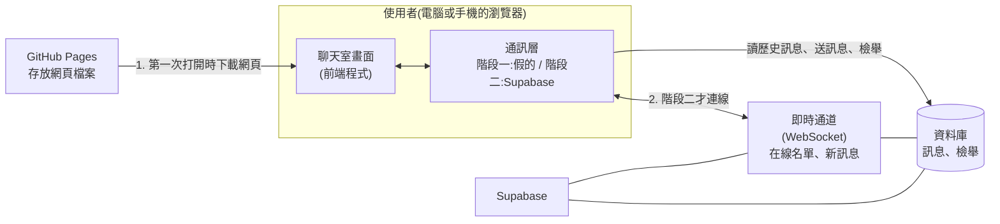

# 匿名聊天室:架構文件

> 讀者:不寫程式的專案負責人。專有名詞第一次出現時會用一句話解釋。
> 需求來源:`docs/requirements.md`(原始想法)、`docs/design.md`(一問一答確定的使用者行為)。
> 視覺風格(顏色、字型)不在這份文件,那是 /design 的工作。

---

## 1. 專案說明與目標

做一個**不用註冊、不用登入**的匿名聊天室。任何人拿到網址,輸入一個代號,就進到同一個聊天室,看得到線上有誰、看得到最近 50 則訊息、可以發訊息。電腦和手機都能用,手機優先。

**目標**

1. 先把前端(使用者在瀏覽器裡看到、點到的部分)做完,放上 GitHub Pages 看得到效果。
2. 最後才接上 Supabase,讓不同的人之間真的能即時傳訊。
3. 接上 Supabase 時,前端不用重寫,只換掉「通訊」那一小塊。

**名詞**

- **前端**:跑在使用者瀏覽器裡的網頁程式,負責畫面和操作。
- **GitHub Pages**:GitHub 提供的免費網頁空間,只能放「現成的網頁檔案」,自己不能跑伺服器程式。
- **Supabase**:一個現成的後端服務(別人幫你架好、維護的伺服器),提供資料庫和即時傳訊。
- **WebSocket**:瀏覽器和伺服器之間一條一直開著的「專線」,有新訊息時伺服器可以主動推給你,不用你一直去問。

---

## 2. 整體架構圖



**怎麼讀這張圖**

- GitHub Pages 只負責「把網頁交給你的瀏覽器」。之後聊天內容**不會經過它**。
- 網頁載入後,瀏覽器直接跟 Supabase 說話(訊息、在線名單都走這裡)。
- 「通訊層」是前端裡專門負責跟外界說話的一小塊。階段一它是假的(只在瀏覽器裡模擬),階段二換成真的 Supabase。**畫面完全不知道通訊層背後是誰。**

---

## 3. 技術選擇

| 項目 | 選了什麼 | 為什麼 |
|------|----------|--------|
| 前端語言 | **TypeScript** | 它是 JavaScript 加上「資料長什麼樣子」的標註。第 5 節的訊息格式會寫成明確的型別,通訊層換成 Supabase 時,資料格式對不上會在建置階段就報錯,不會等到使用者撞到才發現。對不是寫程式的人來說,這等於多一道自動檢查。 |
| 前端框架 | **React** | 最多人用、資料和教學最多、AI 工具最熟。聊天室的畫面會一直變動(新訊息、人進人出),React 擅長「資料變了,畫面自動跟著更新」。 |
| 建置工具 | **Vite** | 把我們寫的程式打包成 GitHub Pages 能放的靜態檔案(`build`),本機預覽很快。 |
| 即時傳訊 | **Supabase Realtime**(Supabase 的即時功能)裡的兩個部分:<br/>① **Presence**(在線狀態):誰在線上<br/>② **Postgres Changes**(資料庫變更推播):新訊息 | 見下方說明。 |
| 儲存訊息 | **Supabase 資料庫**(Postgres,一種常見的資料庫) | 需求要求「最近 50 則」且「全部人離開後仍保留」,所以訊息必須存起來,不能只在記憶體裡。 |
| 身分 | **Supabase 匿名登入**(Anonymous sign-in) | 使用者看不到、不用輸入任何東西。瀏覽器會悄悄拿到一個隨機身分編號。這樣我們才能做到「同一人對同一則訊息只檢舉一次」、「只能用自己的身分寫入」。這**不違反**「不要註冊登入」,使用者完全無感。 |
| 網頁放置 | **GitHub Pages**,用 **GitHub Actions**(GitHub 的自動化流程,你推送程式碼後它自動幫你打包上線)部署 | 需求指定 GitHub Pages;自動部署讓你不用手動上傳檔案。 |

**為什麼訊息走「資料庫變更推播」,在線名單走 Presence?**

- 訊息要**存起來**而且**順序不能亂**。做法是「先寫進資料庫,資料庫再把這筆新資料推給所有人」。這樣「存起來」和「即時收到」是同一件事,不會出現「大家看到了但歷史裡沒有」。
- 在線名單是**暫時的狀態**,人走了就該消失,不需要存。Presence 就是為此設計的,它會自動偵測誰連著、誰斷了。

**沒選的做法**

- Supabase 的 **Broadcast**(純廣播,不存資料):快,但訊息不會保存,做不出「最近 50 則」,所以不單獨使用。
- 自己架伺服器:GitHub Pages 不能跑伺服器,而且你不想維護。

---

## 4. 兩個階段

### 階段一:還沒接 Supabase

**要能做到什麼程度**:`docs/design.md` 裡所有畫面和行為都要能操作,只是資料不是真的從伺服器來。

- 輸入代號、進入聊天室、送訊息、看到自己的訊息靠右。
- 字數限制、空白擋下、重複代號自動加編號。
- 在線人數與名單(電腦版右側)、進入/離開提示。
- 「有 N 則新訊息 ↓」按鈕、標題閃爍、檢舉按鈕。
- 斷線提示條(提供一個測試用開關可以手動觸發,方便看效果)。

**階段一怎麼模擬「別人」**

- **通訊層用「假的」實作**:用瀏覽器內建的 **BroadcastChannel**(同一個瀏覽器的不同分頁之間可以互傳訊息的功能)。你**開兩三個分頁**,就等於兩三個人在聊天,在線名單和進出提示都會真的動。
- 歷史訊息存在該瀏覽器自己的 **localStorage**(瀏覽器的小型儲存空間),重新整理不會消失。
- 另外附一個「示範用機器人」開關,讓只有一個人測試時也有人說話。

**限制(要先知道)**:階段一只有「同一個瀏覽器、同一台電腦」裡的分頁互通。你用手機開,和電腦上的是**兩個不同的聊天室**。要真的跨裝置,必須等階段二。

**怎麼在 GitHub Pages 看到效果**:推送程式碼後,GitHub Actions 自動打包上線(見第 12 節)。你打開網址就能看到畫面,自己開多個分頁測試。

### 階段二:接上 Supabase 之後的改變

只改三件事:

1. 新增「Supabase 版」通訊層,取代「假的」通訊層。
2. 新增環境設定(網址與公開金鑰,見第 8 節)。
3. 在 Supabase 後台建立資料表與權限規則(見第 8、9 節)。

**畫面程式、資料格式、輸入檢查、字數限制:全部不動。**

### 兩個階段之間怎麼設計,才不用重寫

核心做法:**畫面只認一份「合約」,不認得誰在實作。**

這份合約叫 `ChatTransport`(通訊介面,就是一張「通訊層必須會做哪些事」的清單),內容只有:

| 能做的事 | 說明 |
|----------|------|
| `connect(代號)` | 進入聊天室,回傳實際使用的代號(可能被加上 `#2`) |
| `disconnect()` | 離開 |
| `sendMessage(文字)` | 送出訊息 |
| `reportMessage(訊息編號)` | 檢舉 |
| `loadRecent(50)` | 取得最近 50 則歷史 |
| `loadSince(最後一則的編號)` | 斷線重連後補回錯過的訊息 |
| `on(事件, 處理函式)` | 監聽事件(事件清單見第 5 節) |

- 階段一:`MockTransport` 實作這份清單。
- 階段二:`SupabaseTransport` 實作**同一份**清單。
- 畫面透過一個地方(`createTransport()`)拿到通訊層,由設定決定給哪一個。換階段只改這一行設定。

**規則**:畫面程式碼裡**不可以**出現 `supabase` 這個字。檢查方式見第 13 節。

---

## 5. 通訊約定

### 事件名稱

通訊層對畫面「廣播」的事件(畫面只聽這些):

| 事件 | 何時發生 |
|------|----------|
| `message` | 有一則新訊息(包含自己送的) |
| `presence` | 在線名單有變動(附上完整的最新名單) |
| `user_joined` | 有人進來(用來顯示「小華 進來了」) |
| `user_left` | 有人離開(用來顯示「小華 離開了」) |
| `connection` | 自己的連線狀態變了:`connected` / `reconnecting` / `disconnected` |

### 資料格式

以下用 JSON(一種用文字表示資料的通用格式)表示。

**訊息 `ChatMessage`**

```json
{
  "id": 1024,
  "nickname": "小明#2",
  "text": "大家好",
  "sentAt": "2026-10-13T14:32:05Z",
  "senderId": "a1b2c3…"
}
```

- `id`:訊息編號,**遞增**,用來排序和「補上錯過的訊息」。
- `senderId`:匿名身分編號,用來判斷「是不是自己送的」(靠右顯示)與檢舉。**不顯示給使用者。**
- `sentAt`:一律用標準時間,畫面再轉成使用者當地時間(例如 14:32)。

**在線使用者 `OnlineUser`**

```json
{ "senderId": "a1b2c3…", "nickname": "小明#2", "joinedAt": "2026-10-13T14:30:00Z" }
```

**檢舉 `Report`**

```json
{ "messageId": 1024, "reporterId": "d4e5f6…", "reportedAt": "2026-10-13T14:35:00Z" }
```

**系統提示(進入/離開)**:不存進資料庫,只是畫面上的置中小字,由 `user_joined` / `user_left` 事件產生。

### 資料表(階段二才會建立)

| 表 | 欄位 |
|----|------|
| `messages` | id、nickname、text、sent_at、sender_id |
| `reports` | id、message_id、reporter_id、reported_at;同一組 (message_id, reporter_id) 只能有一筆 |

---

## 6. 資料流

### 進入聊天室

1. 使用者在首頁輸入代號,按「進入」。
2. 前端先檢查:不是空白、不超過 12 字。不合規就在輸入框下方顯示原因,不往下走。
3. 呼叫 `connect(代號)`。
4. 通訊層看目前在線名單,如果有同名就加編號(`小明` → `小明#2`;已有 `#2` 就用 `#3`)。
5. 通訊層把自己加進在線名單,載入最近 50 則歷史。
6. 畫面切到聊天室,顯示歷史訊息,捲到最底。其他人看到「小明#2 進來了」。

> 階段二的已知小缺口:兩人**同一瞬間**用同一個代號進來,可能都拿到同一個編號。機率很低、後果輕微(只是兩人看起來同名),第一版接受,不為此加複雜機制。

### 送出訊息

1. 使用者輸入文字,按送出(或 Enter)。
2. 前端檢查:去掉前後空白後不能是空的、不超過 200 字。
3. 呼叫 `sendMessage(文字)`。
4. 階段二:訊息寫進資料庫 → 資料庫把新訊息推給**所有人(包括自己)** → 各自畫面收到 `message` 事件並顯示。
   自己的訊息也是等這個事件才出現,這樣畫面上看到的順序和大家一致。
5. 收到訊息時:如果使用者在最底下,自動捲到最新;如果正在往上翻,不動,顯示「有 N 則新訊息 ↓」。
6. 如果頁面不在前景,網頁標題變成 `(N) 匿名聊天室`;回到頁面時恢復。

### 離開

1. 使用者關閉分頁或網頁(沒有「登出」按鈕,這一版不需要)。
2. 瀏覽器斷開連線,Supabase 發現這個人不見了。
3. 其他人的畫面:名單移除該人,顯示「小明#2 離開了」(套用下一段的寬限規則)。

### 斷線重連

1. 前端偵測到連線中斷 → 頂端顯示「連線中斷,重新連線中…」,輸入框暫時不能送出。
2. 通訊層自動重試連線。
3. **30 秒內恢復**:不通知任何人,當作沒發生。實作方式:其他人的前端收到「某人離開」後,**先等 30 秒再顯示**;若這 30 秒內同一人又回來,就取消顯示。
4. 恢復後:呼叫 `loadSince(最後一則的編號)` 補上錯過的訊息,提示條消失。**代號不變。**
5. **超過 30 秒還沒回來**:其他人才看到「小明#2 離開了」。他之後回來,視為重新進入(走「進入聊天室」流程,代號可能因而重新編號)。

---

## 7. 畫面清單

只有兩個主要畫面。**不規定顏色與樣式。**

### 畫面 A:首頁(輸入代號)

| 元素 | 行為 |
|------|------|
| 聊天室名稱 | 顯示名稱,純文字 |
| 代號輸入框 | 最多 12 字,可輸入中文、英文、數字、表情符號;顯示「還能輸入 N 字」,超過時不讓繼續打 |
| 錯誤提示區 | 代號空白或全空白時顯示原因 |
| 「進入」按鈕 | 檢查通過才進入聊天室;Enter 鍵等同按下 |
| 提醒小字 | 「這是匿名聊天室,訊息會保留最近 50 則,請勿發布個人資料」 |

### 畫面 B:聊天室

| 元素 | 行為 |
|------|------|
| 頂端列 | 顯示聊天室名稱、**目前在線人數**(手機版點它不會展開,只顯示數字) |
| 連線提示條 | 平時隱藏;斷線時顯示「連線中斷,重新連線中…」,恢復後自動消失 |
| 在線名單(**僅電腦版,固定右側**) | 列出所有在線代號,自己標示出來;人進出時即時更新 |
| 訊息區 | 每則顯示代號、內容、時間(如 14:32);自己的靠右、別人的靠左;可上下捲動 |
| 系統提示 | 置中小字:「小華 進來了」「小華 離開了」 |
| 「有 N 則新訊息 ↓」按鈕 | 只在使用者正往上翻舊訊息、又有新訊息時出現;點了跳到最底並消失 |
| 檢舉按鈕 | 出現在**別人的**每則訊息旁(自己的不顯示);按下後該則顯示「已檢舉」,不能再按 |
| 訊息輸入框 | 最多 200 字,顯示「還能輸入 N 字」,超過時不讓繼續打 |
| 「送出」按鈕 | 內容為空白時不能按;Enter 送出;送出成功後清空輸入框 |
| 網頁標題 | 頁面在背景時有新訊息:`(N) 匿名聊天室`,回到前景恢復 |

**響應式規則**:手機優先。手機版沒有名單,只有人數;電腦版右側固定顯示名單。

**配色**:跟著使用者裝置的深色/淺色模式自動切換(細節交給 /design)。

---

## 8. 金鑰

階段一**完全沒有金鑰**。以下是階段二才會碰到的。

### 這個專案會用到的

| 名稱 | 是什麼 | 能公開嗎 |
|------|--------|----------|
| **專案網址**(Project URL) | 你的 Supabase 專案的網址 | ✅ 可以 |
| **公開金鑰**(Supabase 稱 `anon key` 或 `publishable key`) | 讓網頁能連到你的 Supabase。權限很小,只能做「資料庫規則」允許的事 | ✅ 可以。它**一定**會出現在網頁程式裡,任何人按 F12 都看得到,這是設計如此 |
| **私密金鑰**(`service_role key` 或 `secret key`) | 擁有**完全權限**,可以無視所有規則讀寫刪所有資料 | ❌ **絕對不能公開**,也**不要放進這個專案的任何地方** |
| **資料庫密碼** | 建立專案時設定的,用來直接連資料庫 | ❌ **絕對不能公開** |
| **你的 Supabase 帳號密碼** | 登入後台的帳密 | ❌ **絕對不能公開** |

**為什麼公開金鑰公開也安全?** 因為真正的保護是資料庫的**權限規則**(Supabase 稱 **RLS**,Row Level Security,「每一筆資料誰能讀、誰能寫」的規則,見第 9 節)。公開金鑰只是門牌號碼,規則才是門鎖。**所以 RLS 一定要設,這是階段二最重要的一步。**

### 怎麼產生

1. 到 supabase.com 註冊,新增專案(同時設定資料庫密碼,存進你的密碼管理工具)。
2. 專案建好後,在後台的 **Project Settings → API** 頁面可以看到「專案網址」和「公開金鑰」。這兩個**不是我們產生的,是 Supabase 自動給的**。
3. 在後台的 **Authentication** 設定中打開 **Anonymous sign-ins**(匿名登入)。

### 放在哪裡

| 情況 | 放哪 |
|------|------|
| 你自己的電腦(本機預覽) | 專案根目錄的 `.env.local` 檔案(**不進 git**) |
| 範本 | `.env.example`,只寫變數名稱、值留空,**可以進 git**,讓你知道要填什麼 |
| GitHub 上自動打包時 | GitHub 專案的 **Settings → Secrets and variables → Actions**,存成 `VITE_SUPABASE_URL` 和 `VITE_SUPABASE_ANON_KEY` |

`VITE_` 開頭是 Vite 的規則:只有這個開頭的變數才會被放進網頁。**我們故意不給任何私密金鑰這個開頭**,即使放錯也不會被打包進網頁。

> 老實說:公開金鑰最終還是會在打包出來的網頁裡。放在 GitHub Secrets 是為了「不要把它寫死在程式碼和 git 紀錄裡」,方便日後更換,不是為了保密。

### 怎麼避免被 commit 到 GitHub

1. `.gitignore`(告訴 git「這些檔案不要追蹤」的清單)**一開始就包含**:
   ```
   .env
   .env.*
   !.env.example
   node_modules/
   dist/
   ```
2. `CLAUDE.md` 已寫明「不可以把金鑰檔案 commit 進 git」,AI 助手做事時會遵守。
3. **每次 commit 前**檢查 `git status`,看有沒有 `.env` 開頭的檔案出現在待提交清單。
4. 萬一不小心 commit 了:**不要只是刪掉檔案**,因為 git 會記得歷史。要到 Supabase 後台**重新產生(rotate)金鑰**,舊的就作廢。這是唯一可靠的補救。
5. 管理者刪訊息用 **Supabase 網頁後台**(用你的帳號登入),**不需要**把私密金鑰放進任何程式。

---

## 9. 安全與限制

### 別人可能送什麼奇怪的東西

| 風險 | 前端怎麼擋 | 階段二還要在資料庫端擋(因為前端可被繞過) |
|------|-----------|------------------------------------------|
| 超長代號或訊息 | 字數限制,超過不讓打 | 資料庫欄位加長度限制(代號 12、訊息 200) |
| 空白訊息 | 送出按鈕停用 | 資料庫拒絕空白字串 |
| 夾帶 HTML / 程式碼(例如 `<script>`,試圖在別人的瀏覽器執行惡意程式,稱為 **XSS**) | 訊息**一律當純文字顯示**,絕不當網頁內容解讀。React 預設就這樣做,**禁止使用會繞過這個保護的寫法** | 不需要 |
| 假冒別人 | 代號不是身分;系統用隱藏的匿名身分編號辨認「這是不是我送的」 | 規則:`sender_id` 只能等於自己的身分,不能填別人的 |
| 偽造/竄改/刪除別人的訊息 | — | 規則:一般使用者只能新增,不能修改、刪除任何訊息 |
| 讀取檢舉紀錄 | — | 規則:一般使用者只能新增檢舉,不能讀取 |
| 刷屏洗版 | **這一版不做防洗版**(見第 10 節) | 只靠檢舉與管理者手動刪除。這是已知風險 |
| 有人用奇怪字元(超多零寬字元、極長無空格字串)弄壞版面 | 訊息區設定長字串自動換行 | — |

### 免費方案的上限(階段二要注意)

以下數字是撰寫時的大概值,**接上 Supabase 前請到官方方案頁面確認最新數字**:

| 項目 | 大概的上限 | 對我們的影響 |
|------|-----------|--------------|
| 同時在線連線數 | 約 200 | 同時超過約 200 人,新來的連不上。小型聊天室夠用 |
| 每秒即時訊息數 | 約 100 | 洗版者可以占用很多額度 |
| 資料庫大小 | 約 500 MB | 純文字訊息很小,短期內不是問題;若要控制,可定期清掉太舊的訊息 |
| 專案閒置暫停 | 免費專案久沒人用(約一週)會被**暫停** | 暫停後網站會連不上,要到後台手動恢復。長期沒人用要留意 |
| GitHub Pages | 網站約 1 GB、每月流量約 100 GB | 我們的網頁很小,不用擔心 |

資料庫會保存**所有**訊息,畫面只顯示最近 50 則。

---

## 10. 這一版刻意不做的事

| 不做 | 為什麼 |
|------|--------|
| 註冊、登入 | 需求明確不要。(匿名登入是看不見的技術細節,見第 3 節) |
| 提示音 | 手機瀏覽器常常擋;改用標題閃爍即可 |
| 防洗版(限制送太快) | 使用者決定不做。代價是洗版只能靠檢舉和管理者手動處理 |
| 敏感字過濾 | 中文很難做準,容易誤擋或被繞過;改用檢舉 |
| 網址可點擊 | 使用者決定不做;順便少一個安全風險(惡意連結) |
| 「正在輸入…」提示 | 使用者決定不做 |
| 圖片、檔案 | 增加儲存與安全風險 |
| 編輯、刪除自己的訊息 | 使用者決定不做;也避免「說過的話消失」的爭議 |
| 私訊、多個聊天室 | 需求是「所有人在同一個聊天室」 |
| 封鎖、禁言、管理者介面 | 管理者用 Supabase 後台手動處理即可;自己做一套後台太大 |
| 登出按鈕 | 關掉網頁就是離開 |
| 手機版顯示在線名單 | 使用者決定只顯示人數,保留聊天區空間 |

---

## 11. repo 的資料夾結構

repo(儲存庫)就是放這個專案所有檔案的資料夾。

```
anonymous-chat/
├─ CLAUDE.md                  給 AI 助手的工作規則
├─ README.md
├─ .gitignore                 不要追蹤的檔案(含金鑰)
├─ .env.example               環境變數範本(只有名稱,沒有值)
├─ package.json               專案設定與相依套件清單
├─ vite.config.ts             打包設定(含 GitHub Pages 的網址路徑)
├─ index.html
├─ docs/
│  ├─ requirements.md         原始需求
│  ├─ design.md               使用者行為決定
│  └─ architecture.md         本文件
├─ .github/
│  └─ workflows/
│     └─ deploy.yml           自動打包並上線到 GitHub Pages
├─ supabase/                  階段二才新增
│  └─ schema.sql              建立資料表與權限規則的指令稿
└─ src/
   ├─ main.tsx                程式進入點
   ├─ App.tsx                 在「首頁」與「聊天室」間切換
   ├─ types.ts                第 5 節的資料格式定義
   ├─ config.ts               讀取環境設定、決定用哪個通訊層
   ├─ screens/
   │  ├─ EntryScreen.tsx      畫面 A
   │  └─ ChatScreen.tsx       畫面 B
   ├─ components/             訊息列表、輸入框、在線名單、連線提示條…
   ├─ hooks/                  共用邏輯(自動捲動、標題閃爍…)
   ├─ transport/              ★ 通訊層,階段二只動這個資料夾
   │  ├─ ChatTransport.ts     「合約」:通訊層必須會做的事
   │  ├─ MockTransport.ts     階段一:假的
   │  ├─ SupabaseTransport.ts 階段二:真的
   │  └─ createTransport.ts   依設定決定用哪個
   └─ lib/
      └─ validation.ts        代號、訊息的檢查規則(字數、空白)
```

---

## 12. 部署到 GitHub Pages 的方式

**一次性設定**

1. 在 GitHub 專案的 **Settings → Pages**,把 **Source** 選為 **GitHub Actions**。
2. 確認 `vite.config.ts` 的 `base`(網頁放在網址的哪一層)設為 `/anonymous-chat/`。
   原因:GitHub Pages 的網址會是 `https://<帳號>.github.io/anonymous-chat/`,網頁在子路徑底下。這個沒設對,上線後會整頁空白(找不到檔案)。
3. 階段二時,再到 Settings → Secrets and variables → Actions 填入兩個值(第 8 節)。

**平常上線流程**

1. 把修改推送(push)到 `main` 分支。
2. `.github/workflows/deploy.yml` 自動執行:安裝相依套件 → 打包(build)→ 發布到 GitHub Pages。
3. 一兩分鐘後,打開網址就看到新版。到專案的 **Actions** 分頁可以看到成功或失敗。

**本機預覽**:在你的電腦啟動預覽,會給你一個 `localhost` 開頭的網址,只有你自己看得到,用來上線前先看效果。

---

## 13. 驗證清單

### 階段一(完全不碰 Supabase)

**功能**

- [ ] 首頁:代號空白、全空白,不能進入並顯示原因
- [ ] 首頁:輸入第 13 個字時打不進去,並顯示「還能輸入 0 字」
- [ ] 能輸入中文、英文、數字、表情符號
- [ ] 進入聊天室,看得到歷史訊息(重新整理後仍在,最多 50 則)
- [ ] 送出訊息:自己的靠右、有時間、有代號
- [ ] 空白訊息送不出去;第 201 個字打不進去
- [ ] 開第二個分頁用同名進入,第二人變成 `名字#2`
- [ ] 兩個分頁互傳訊息,對方靠左
- [ ] 一個分頁進來/關閉,另一個分頁看到進入/離開提示與名單更新
- [ ] 往上翻舊訊息時有新訊息:畫面不動,出現「有 N 則新訊息 ↓」,點了跳到底並消失
- [ ] 在最底下時新訊息:自動捲到最新
- [ ] 切到別的分頁收到訊息,標題變成 `(N) 匿名聊天室`;切回來恢復
- [ ] 別人的訊息有檢舉按鈕、自己的沒有;按下變「已檢舉」不能再按
- [ ] 用測試開關觸發斷線:顯示提示條、輸入框停用;恢復後提示消失並補上訊息
- [ ] 斷線 30 秒內恢復:其他分頁不顯示離開;超過 30 秒:顯示離開

**畫面**

- [ ] 手機寬度:沒有橫向捲軸、沒有名單、只有人數
- [ ] 電腦寬度:右側有名單
- [ ] 切換裝置的深色/淺色模式,畫面跟著變
- [ ] 訊息裡輸入 `<b>粗體</b>` 和 `<script>`,畫面上原樣顯示成文字,不會變粗體或執行

**專案**

- [ ] 打包(build)沒有錯誤
- [ ] 本機預覽能正常操作
- [ ] 推送後 GitHub Actions 成功,GitHub Pages 網址能打開,**不是空白頁**
- [ ] 在 `src/screens/` 和 `src/components/` 裡搜尋 `supabase`,**找不到任何結果**
- [ ] `git status` 看不到任何 `.env` 開頭的檔案(`.env.example` 除外)

### 階段二(接上 Supabase)

**設定**

- [ ] 已打開 Anonymous sign-ins
- [ ] 資料表已建立,**RLS 已啟用**
- [ ] 專案裡沒有私密金鑰、資料庫密碼(全專案搜尋確認)
- [ ] GitHub Secrets 已填入網址與公開金鑰

**功能(用兩台不同的裝置,例如電腦加手機)**

- [ ] 兩台裝置互傳訊息,即時出現
- [ ] 在線名單與進入/離開提示跨裝置正常
- [ ] 同名進入,第二人變 `#2`
- [ ] 新加入的人看得到最近 50 則,不多不少
- [ ] 全部人離開後再有人進來,歷史訊息還在
- [ ] 手機切換網路(如 Wi-Fi 換 4G/5G)或開關飛航模式:出現重連提示,恢復後補上錯過的訊息,代號不變
- [ ] 檢舉後,在 Supabase 後台看得到檢舉紀錄;同一人對同一則重複檢舉只算一筆
- [ ] 在 Supabase 後台刪除一則訊息,新進來的人看不到它

**安全**

- [ ] 用瀏覽器開發者工具嘗試直接送 201 字的訊息、空白訊息:資料庫拒絕
- [ ] 嘗試用別人的身分編號寫入:被拒絕
- [ ] 嘗試修改或刪除訊息:被拒絕
- [ ] 嘗試讀取檢舉紀錄:被拒絕

**階段一的項目也全部重測一次**,確認換通訊層後沒有東西壞掉。
